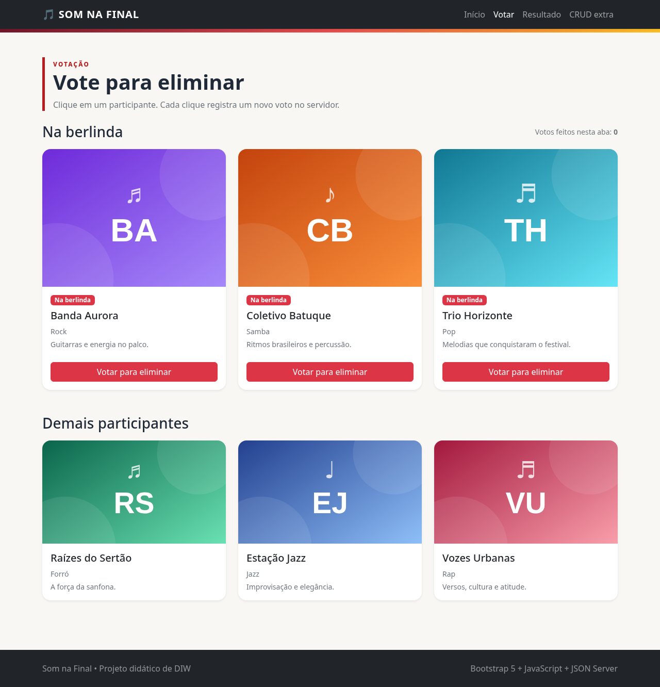
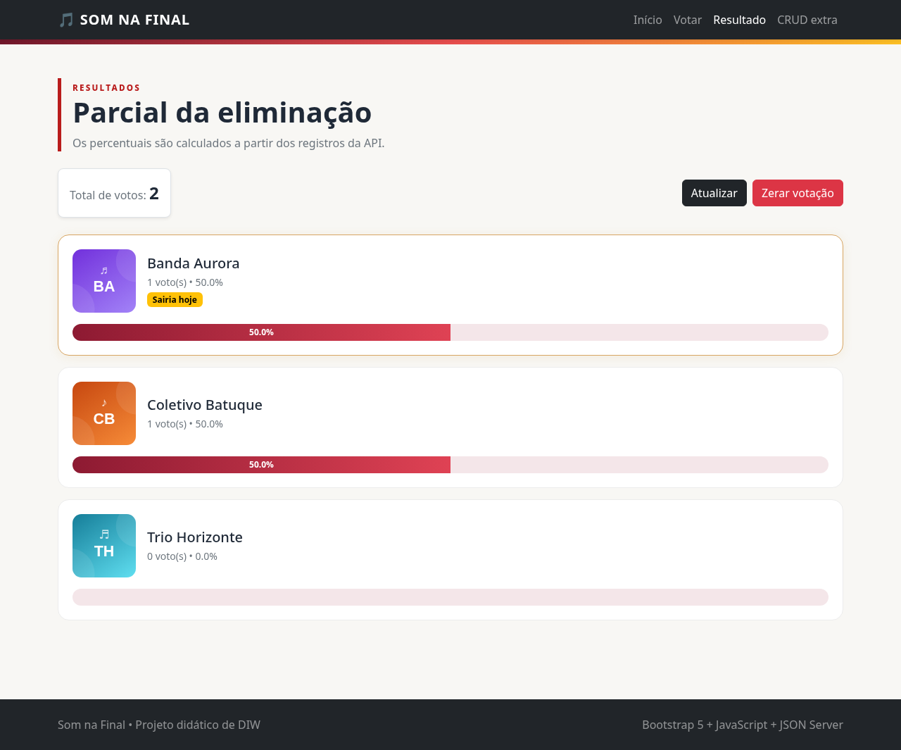

# SOM NA FINAL — Repositório completo de revisão DIW

**Projeto prático de consulta e treino** baseado nos tópicos da avaliação de DIW de uma outra turma: páginas responsivas com Bootstrap 5 e operações HTTP usando JavaScript, Fetch API e JSON Server.

> **Para revisão e consulta somente quando autorizada pelo professor.** O fato de a prova de outra turma permitir consultar projetos próprios não garante que projetos fornecidos por terceiros estejam liberados na sua turma.

## Comece por aqui

### Opção A — JSON Server (modelo de prova)

1. Abra **esta pasta raiz** no VS Code.
2. No terminal do Windows PowerShell:

   ```powershell
   npm.cmd install
   npm.cmd start
   ```

3. Acesse **http://localhost:3000/** no navegador.
4. Veja as rotas da API: **http://localhost:3000/participantes** e **http://localhost:3000/votos**.

O servidor usa **json-server 0.17.4**, pois a versão 1 tem diferenças de comportamento. O pacote precisa estar instalado pelo `npm.cmd install` (internet na instalação).

### Opção B — Sem npm ou internet (para treinar)

Se o computador tiver Node.js mas não permitir instalar dependências, execute:

```powershell
node servidor-offline.js
```

Depois abra **http://localhost:3000/**. Esse arquivo implementa uma API de treino semelhante, com módulos nativos do Node.js, sem dependências externas. **Não substitui o JSON Server se a avaliação exigir especificamente JSON Server.**

### Bootstrap funciona offline

Os arquivos **Bootstrap 5.3.6** estão copiados em `public/vendor/bootstrap/`. Navbar, modal, grid e cards não precisam de acesso a CDN.

## Páginas

| Página | Funcionalidades | O que estudar |
|---|---|---|
| `public/index.html` | Home, navbar, grid, destaque e cards dinâmicos | `container`, `row`, `col-md-*`, `GET` e DOM |
| `public/votacao.html` | Cards dinâmicos e botão de voto | `GET ?naRoca=true/false`, `POST`, eventos e alert |
| `public/resultado.html` | Contagem, percentuais, ordenação, progress e modal | `GET`, `filter`, `sort`, porcentagem, `DELETE` |
| `public/admin.html` | CRUD de participantes (extra) | Formulário, `POST`, `PUT`, `PATCH`, `DELETE` |

## Onde está o código que eu preciso?

| Quero fazer... | Abra este arquivo | Procure por... |
|---|---|---|
| Menu que vira hambúrguer | `public/index.html` | `navbar-expand-md`, `navbar-toggler` e `collapse` |
| Grid Bootstrap | `public/votacao.html` | `row-cols-1 row-cols-md-3` |
| Importar CSS/JS corretamente | `public/index.html` | `<link>` e `<script defer>` |
| Buscar dados da API | `public/js/api.js` | `listarParticipantes` e `requisitar` |
| Filtrar na URL | `public/js/api.js` | `?naRoca=` |
| Criar um card pelo JS | `public/js/ui.js` | `function criarCard` |
| Reagir a clique | `public/js/votacao.js` | `addEventListener('click'` |
| Enviar JSON com POST | `public/js/api.js` | `votar(participanteId)` |
| Mostrar aviso de sucesso | `public/js/ui.js` | `mostrarAviso` |
| Contar ocorrências | `public/js/resultado.js` | `votos.filter(...)` |
| Calcular percentual | `public/js/resultado.js` | `(quantidade / total) * 100` |
| Ordenar decrescente | `public/js/resultado.js` | `resultados.sort` |
| Construir barra Bootstrap | `public/js/resultado.js` | `progress-bar` |
| Modal de confirmação | `public/resultado.html` | `modalZerar` |
| Apagar votos com DELETE | `public/js/resultado.js` | `for (const voto of votos)` |
| Fazer formulário sem recarregar | `public/js/admin.js` | `preventDefault()` |
| Editar com PUT | `public/js/api.js` | `substituirParticipante` |
| Alterar só um campo com PATCH | `public/js/api.js` | `mudarStatus` |
| Excluir registro com DELETE | `public/js/api.js` | `excluirParticipante` |

## Estrutura

```text
diw-guia-pratico-repositorio/
├── package.json
├── db.json                 ← banco persistente; JSON Server modifica este arquivo
├── db-inicial.json         ← restaura o estado SEM votos
├── db-exemplo-votos.json   ← conjunto opcional com 4 votos
├── servidor-offline.js     ← alternativa de estudo sem instalar npm
├── README.md
├── GUIA-RAPIDO.md
├── EXERCICIOS.md
├── tests/
│   └── logica.test.mjs
└── public/
    ├── index.html
    ├── votacao.html
    ├── resultado.html
    ├── admin.html
    ├── css/style.css
    ├── js/api.js
    ├── js/ui.js
    ├── js/index.js
    ├── js/votacao.js
    ├── js/resultado.js
    ├── js/admin.js
    ├── img/*.svg
    └── vendor/bootstrap/
```

## Teste do funcionamento (5 minutos)

1. Abra **Votar** e clique em um participante na berlinda.
2. Confirme que aparece um alert de sucesso.
3. Abra **Resultado** e veja a barra de percentual aumentar.
4. Clique em **Zerar votação** → modal → confirmar.
5. Confira se os votos realmente foram removidos de `db.json`.
6. Abra **CRUD extra**, cadastre um participante e altere seu status.
7. Volte a **Votar** para verificar o novo card.

### Atenção sobre a contagem de votos do usuário

O exemplo mantém apenas um **contador de votos desta aba** no `sessionStorage`, para a contagem sobreviver a recargas da página. **Os votos reais não ficam em localStorage/sessionStorage:** cada voto é salvo via POST no `db.json`. O contador não identifica um usuário entre computadores ou sessões; para isso seria necessária autenticação ou identificação persistente. Se preferir uma versão sem nenhuma forma de armazenamento no navegador, substitua o contador por `let votosNestaAba = 0` e retire a chamada a `sessionStorage`.

### Atenção sobre percentuais

O denominador é `votos.length`, conforme o enunciado, assumindo que os votos foram feitos em participantes atualmente na berlinda. Se o professor quiser desconsiderar votos antigos em participantes que saíram da berlinda, filtre os votos válidos antes de calcular percentuais.

## Se não funcionar

- **`'json-server' não é reconhecido`** → execute `npm.cmd install` na raiz.
- **`npm.ps1` bloqueado no PowerShell** → use `npm.cmd`, não `npm`.
- **`ENOENT package.json`** → terminal está em outra pasta. Abra a raiz do projeto.
- **Erro 404 no script ou MIME application/json** → verifique os caminhos em `public/` e o `--static ./public`.
- **Votos não aparecem** → a página deve ser aberta em `http://localhost:3000/`, nunca com `file:///`.
- **Porta 3000 ocupada** → pare outro servidor, ou escolha outra porta no comando.
- **Node não instalado** → JSON Server e o servidor offline precisam do Node.js; instalar o VS Code sozinho não basta.

## Restaurar o banco de exemplo (sem votos)

Pare o servidor com `Ctrl + C` e execute na raiz (PowerShell):

```powershell
Copy-Item .\db-inicial.json .\db.json -Force
```

Para testar diretamente a tela de resultados com quatro votos prontos, pare o servidor e use `Copy-Item .\db-exemplo-votos.json .\db.json -Force`. A configuração padrão, porém, começa com `votos: []`, como no enunciado.

## Para colocar no seu GitHub (em seu computador)

```powershell
git init
git add .
git commit -m "docs: adiciona repositorio de referencia DIW"
git branch -M main
git remote add origin https://github.com/SEU-USUARIO/SEU-REPOSITORIO.git
git push -u origin main
```

Crie primeiro um repositório vazio no GitHub e substitua `SEU-USUARIO/SEU-REPOSITORIO` pelo endereço real.

## Referências

- Bootstrap 5: https://getbootstrap.com/docs/5.3/
- JSON Server 0.17.4: https://github.com/typicode/json-server/tree/v0.17.4
- Fetch API: https://developer.mozilla.org/pt-BR/docs/Web/API/Fetch_API

**Próxima leitura:** abra `GUIA-RAPIDO.md` e faça os exercícios de `EXERCICIOS.md`.

## Prévia visual

As imagens abaixo ilustram o projeto funcionando com dados simulados de teste:






> Os arquivos `preview-*.png` são capturas ilustrativas; não alteram o banco. Ao iniciar o projeto normalmente, `db.json` começa com a lista `votos` vazia.
